# LSEG MCP Server Interface

## 🧩 Introduction
This project exposes **LSEG API endpoints** as tools for an **MCP (Model Context Protocol) server**, enabling users to query data related to **financial statements**, **earnings calls**, and other **corporate information** for companies covered by **LSEG**. Currently, additional MCP servers are being developed to grant access to other providers, including SEC Edgar and a custom RAG pipeline.

Interaction with the MCP server occurs through a **simple web frontend**, where users can type a question and receive responses directly.



---

## ⚙️ Preliminaries

### 0. Install uv following the steps available at https://docs.astral.sh/uv/getting-started/installation/

### 1. Clone the repository at https://github.com/edoardopilla/lseg_llm_mcp

### 2. Create a .env file in the project root with the following content (replace placeholders with your credentials and API keys):

```
LSEG_USERNAME='ENTER_LSEG_USERNAME'  
LSEG_PASSWORD='ENTER_LSEG_PASSWORD'  
LSEG_EDP_APP_KEY='ENTER_LSEG_EDP_APP_KEY'  
OPENAI_API_KEY='ENTER_OPENAI_API_KEY' (supported providers: Anthropic, Google, Mistral, OpenAI, ZAI)
```

### 3. Install dependencies through uv sync

### 4. Activate virtual environment through .venv\Scripts\activate

---

## 🚀 Running the frontend

### 1. Execute the frontend script through python app.py (default location localhost:8050)

### 2. Access the frontend and type in your question